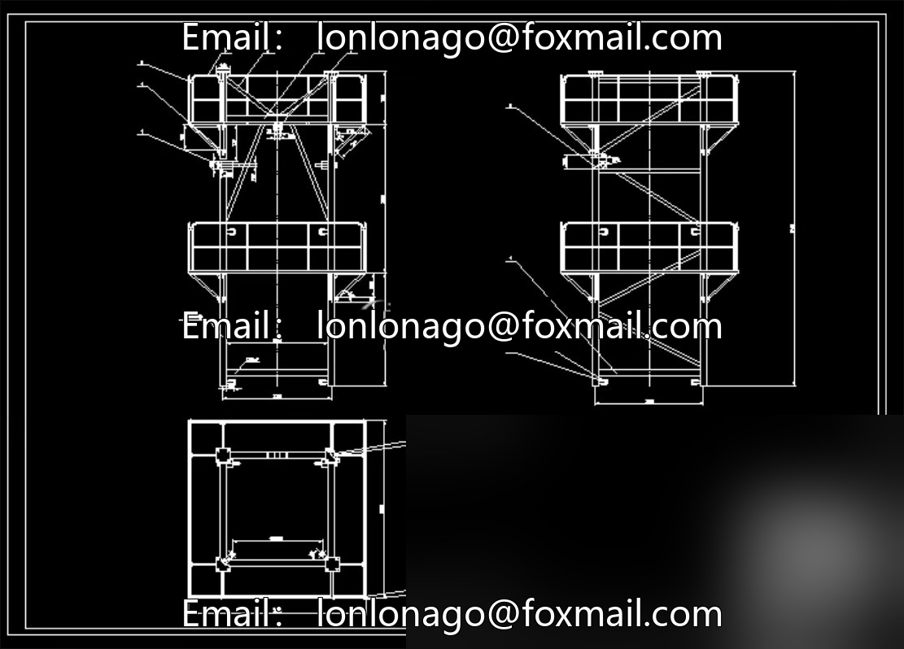
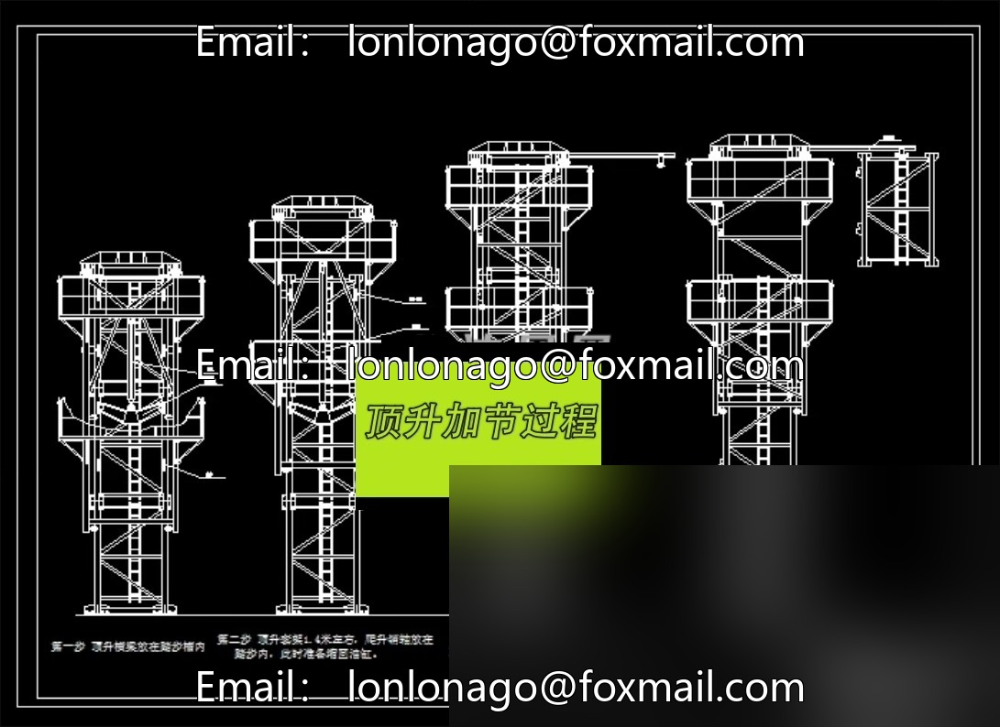

# Tower crane top-raising mechanism design Tower crane top-raising mechanism design diagram Tower crane

## Body

Tower Crane Top Ascending Mechanism Design; Tower Crane Top Ascending Mechanism Design Drawing; Tower Crane Top Ascending Mechanism Design CAD Drawing
156 This design focuses on the structure, force analysis, core force components, and material aspects of the tower crane top ascending mechanism. Taking the QTZ63 model tower crane produced in China as an example, it analyzes the stress conditions of the step and top ascending beam through research and analysis, clarifies the structural and size determination methods for the step and top ascending beam, and determines the key dimensions of the sleeve frame, and determines the hydraulic system of the top ascending mechanism based on the top ascending load. Ensures that the tower crane can safely and stably carry out the top ascending and addition process, ensuring safe construction of the tower crane.

The images show AutoCAD files, design drawings for tower crane top lifting mechanisms, step and lifting beam drawings, as well as set support, climbing rollers, lifting beams, climbing pin shafts and related structural documents.

<!-- AI_ENRICHED -->

## Images

## Payment

Here is a pay link on Stripe ( https://buy.stripe.com/3cs8yP7sY87d0vu9AB ). Please contact me lonlonago@foxmail.com after funding $89, and I will send you a complete data files , thank you!

